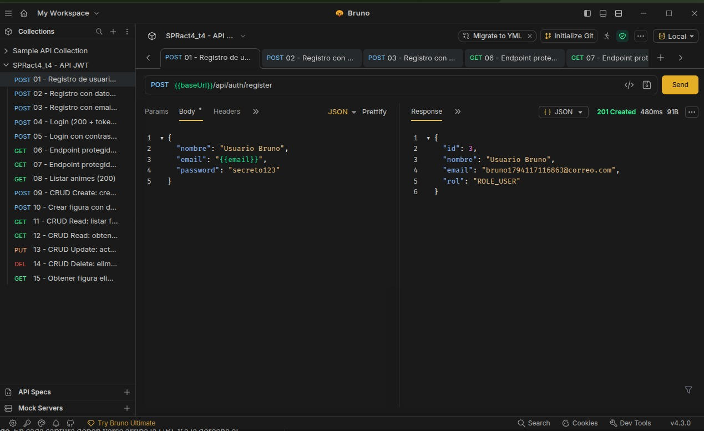
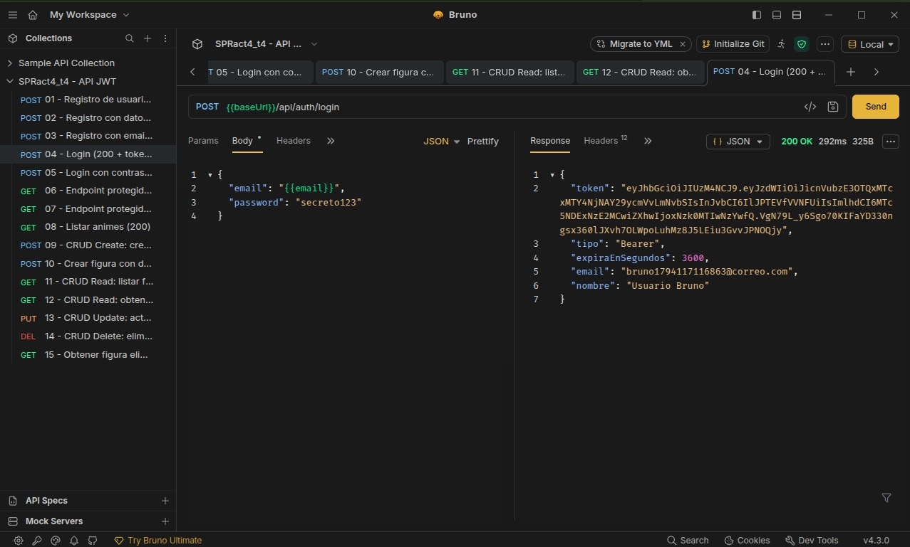
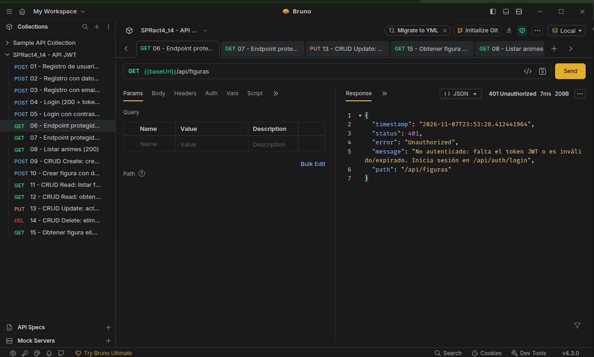
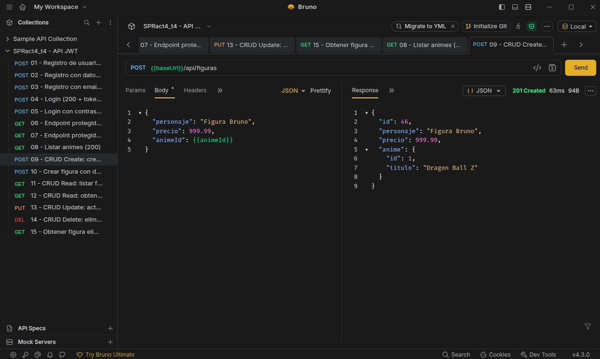
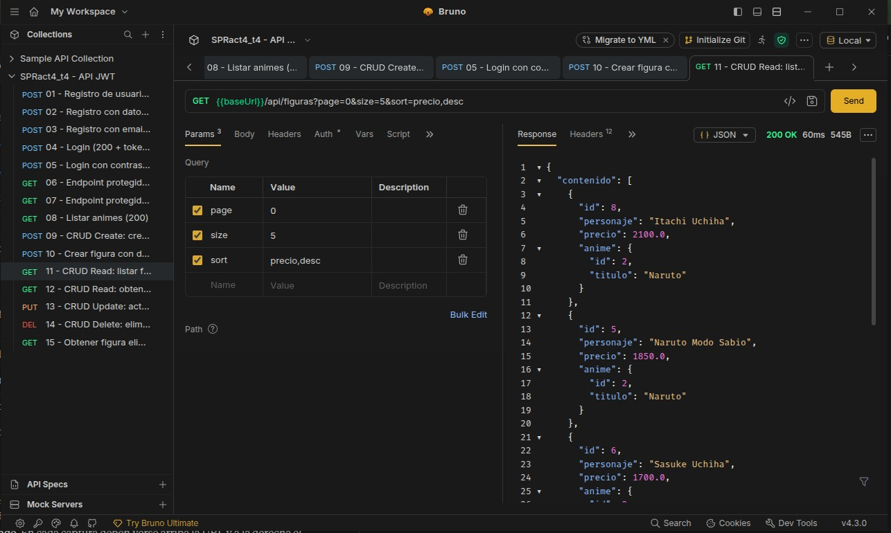
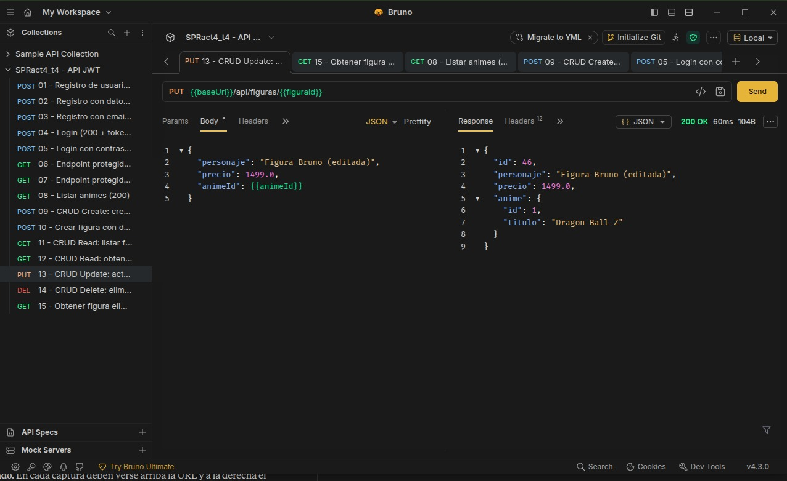
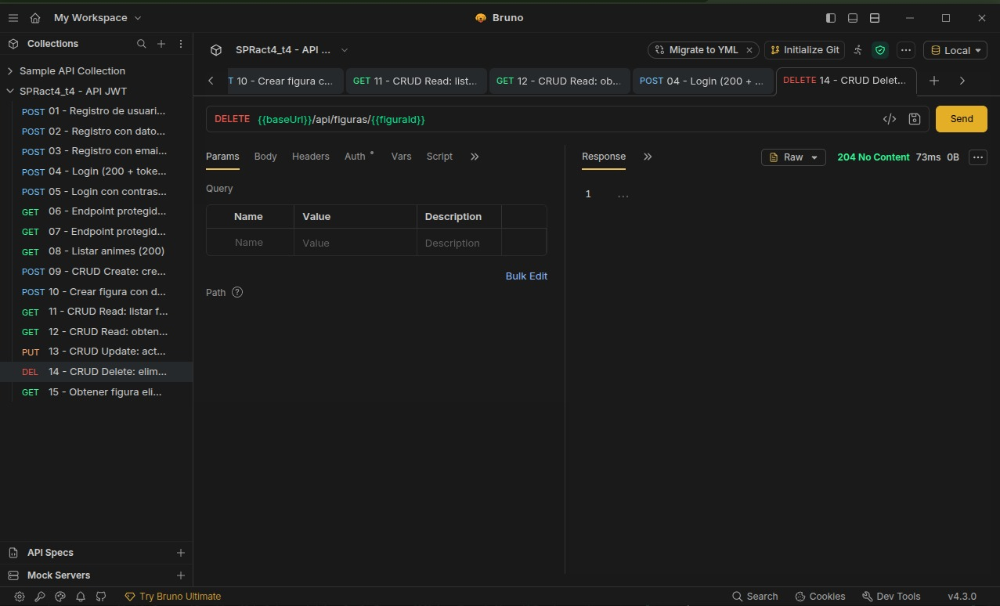
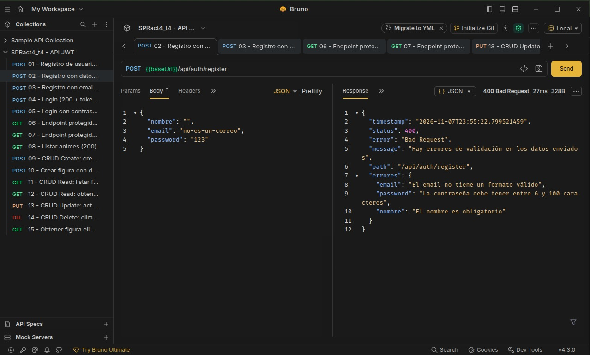

# Actividad 4 - API REST con Spring Security y JWT (SPRact4_t4)

API REST pura (sin vistas) construida con **Spring Boot 3.2.5**, **Spring Security** y **JWT**, que protege el CRUD de **Figuras** (relacionadas con **Animes**, como en la Actividad 3). Persistencia en **PostgreSQL**, pruebas con **Bruno**, desplegada en un VPS (AWS Lightsail).

---

## Tecnologías

| Pieza | Uso |
|---|---|
| Spring Web | Controladores REST, siempre JSON |
| Spring Data JPA + PostgreSQL | Entidades, repositorios, relación 1:N |
| Spring Security | Protección de endpoints, BCrypt, sesión *stateless* |
| jjwt 0.12.5 | Generación y validación de tokens JWT (HS256) |
| Bean Validation | `@Valid`, `@NotBlank`, `@Email`, `@Positive`... en los DTOs |
| Bruno | Colección de pruebas versionada en `/bruno` |

## Estructura

```
src/main/java/com/ejemplo/act4_api_jwt/
├── config/       SecurityConfig, DataLoader (datos de ejemplo)
├── controller/   AuthController, FiguraController, AnimeController
├── dto/          Requests/Responses (RegisterRequest, FiguraRequest, FiguraResponse, PageResponse, ApiError...)
├── entity/       Usuario, Anime, Figura
├── exception/    Excepciones propias + GlobalExceptionHandler
├── repository/   UsuarioRepository, AnimeRepository, FiguraRepository
├── security/     JwtService, JwtAuthFilter, CustomUserDetailsService, manejadores 401/403
└── service/      AuthService, FiguraService, AnimeService
bruno/            Colección de Bruno (15 peticiones + entornos Local y VPS)
deploy/           act4.service (systemd) y act4.env.example
```

## Modelo de datos

- `Usuario` (`usuarios`): id, nombre, email (único), password (hash BCrypt), rol.
- `Anime` (`animes`) **1 ── N** `Figura` (`figuras`): cada figura guarda la llave foránea `anime_id` (`@ManyToOne` / `@OneToMany`).

Al arrancar con la base vacía se cargan 3 animes y 12 figuras de ejemplo (`DataLoader`).

## Endpoints

| Método | Ruta | Auth | Descripción | Códigos |
|---|---|---|---|---|
| POST | `/api/auth/register` | No | Registra un usuario | 201, 400, 409 |
| POST | `/api/auth/login` | No | Devuelve el token JWT | 200, 400, 401 |
| GET | `/api/animes` | JWT | Lista los animes (para conocer sus ids) | 200, 401 |
| GET | `/api/figuras?page=0&size=10&sort=precio,desc` | JWT | Lista **paginada** de figuras | 200, 400, 401 |
| GET | `/api/figuras/{id}` | JWT | Una figura | 200, 401, 404 |
| POST | `/api/figuras` | JWT | Crea una figura | 201, 400, 401 |
| PUT | `/api/figuras/{id}` | JWT | Actualiza una figura | 200, 400, 401, 404 |
| DELETE | `/api/figuras/{id}` | JWT | Elimina una figura | 204, 401, 404 |

Campos permitidos en `sort`: `id`, `personaje`, `precio`. Tamaño máximo de página: 50.

### Ejemplos

Registro: `POST /api/auth/register`
```json
{ "nombre": "Samuel", "email": "samuel@correo.com", "password": "secreto123" }
```
Respuesta `201` (nunca incluye el password):
```json
{ "id": 1, "nombre": "Samuel", "email": "samuel@correo.com", "rol": "ROLE_USER" }
```

Login: `POST /api/auth/login` → `200`
```json
{
  "token": "eyJhbGciOiJIUzI1NiJ9....",
  "tipo": "Bearer",
  "expiraEnSegundos": 3600,
  "email": "samuel@correo.com",
  "nombre": "Samuel"
}
```

Crear figura: `POST /api/figuras` con la cabecera `Authorization: Bearer <token>`
```json
{ "personaje": "Zoro", "precio": 1400.0, "animeId": 3 }
```
Respuesta `201` con cabecera `Location`; la relación se refleja con el anime completo:
```json
{ "id": 13, "personaje": "Zoro", "precio": 1400.0, "anime": { "id": 3, "titulo": "One Piece" } }
```

Error de validación `400`:
```json
{
  "timestamp": "2026-11-08T01:00:00",
  "status": 400,
  "error": "Bad Request",
  "message": "Hay errores de validación en los datos enviados",
  "path": "/api/figuras",
  "errores": {
    "personaje": "El personaje es obligatorio",
    "precio": "El precio debe ser mayor que 0"
  }
}
```

## Cómo funciona la seguridad

1. El cliente se registra y hace login; el servidor devuelve un **JWT** firmado (HS256) con el email como `subject`, el rol, fecha de emisión y expiración (1 hora por defecto).
2. En cada petición protegida el cliente envía `Authorization: Bearer <token>`.
3. `JwtAuthFilter` (antes de `UsernamePasswordAuthenticationFilter`) valida la firma y la expiración, carga al usuario y lo marca como autenticado.
4. `SecurityConfig` deja públicas solo las rutas `/api/auth/**`; todo lo demás exige autenticación. La sesión es *stateless* (sin cookies, CSRF desactivado).
5. Sin token, o con uno inválido o expirado, la API responde **401** en JSON.

Las contraseñas se guardan con **BCrypt**. Los DTOs de respuesta nunca exponen el password ni las entidades JPA directamente.

## Ejecutar en local

Requisitos: Java 17+ y PostgreSQL.

```bash
sudo -u postgres psql -c "CREATE DATABASE act4_db;"
./mvnw spring-boot:run
```

Por defecto usa `postgres` / `123` en `localhost:5432` y el puerto `8085`. Se puede cambiar con variables de entorno: `DB_URL`, `DB_USER`, `DB_PASSWORD`, `JWT_SECRET` (mínimo 32 caracteres), `JWT_EXPIRATION_MS`, `PORT`.

Pruebas unitarias del JWT: `./mvnw test`.

## Pruebas con Bruno

1. Abrir Bruno → **Open Collection** → seleccionar la carpeta `bruno/` de este repositorio.
2. Elegir el entorno **Local** (`http://localhost:8085`) o **VPS** (`http://3.148.185.31:8085`).
3. Ejecutar la colección completa (**Run**) o las peticiones en orden. El *login* guarda el token automáticamente y las demás peticiones lo usan.

| # | Petición | Resultado esperado |
|---|---|---|
| 01 | Registro | 201 |
| 02 | Registro con datos inválidos | 400 |
| 03 | Registro con email repetido | 409 |
| 04 | Login | 200 + token |
| 05 | Login con contraseña incorrecta | 401 |
| 06 | Endpoint protegido **sin token** | 401 |
| 07 | Endpoint protegido con token inválido | 401 |
| 08 | Listar animes | 200 |
| 09 | **Create** figura | 201 |
| 10 | Crear figura con datos inválidos | 400 |
| 11 | **Read** listado paginado | 200 |
| 12 | **Read** figura por id | 200 |
| 13 | **Update** figura | 200 |
| 14 | **Delete** figura | 204 |
| 15 | Figura eliminada | 404 |

## Despliegue en el VPS

```bash
# 1) En la computadora: compilar (el jar se llama SPRact4_t4.jar)
./mvnw clean package -DskipTests

# 2) Subir a una carpeta nueva del VPS
ssh -i LLAVE.pem ubuntu@3.148.185.31 "mkdir -p ~/act4"
scp -i LLAVE.pem target/SPRact4_t4.jar ubuntu@3.148.185.31:~/act4/
scp -i LLAVE.pem deploy/act4.service deploy/act4.env.example ubuntu@3.148.185.31:~/act4/

# 3) En el VPS: base de datos, variables de entorno y servicio
sudo -u postgres psql -c "CREATE DATABASE act4_db;"
cp ~/act4/act4.env.example ~/act4/act4.env && nano ~/act4/act4.env   # poner JWT_SECRET propio
chmod 600 ~/act4/act4.env
sudo cp ~/act4/act4.service /etc/systemd/system/act4.service
sudo systemctl daemon-reload
sudo systemctl enable --now act4
sudo journalctl -u act4 -f
```

Además hay que abrir el puerto **8085** (TCP) en el firewall de Lightsail. Las Actividades 1, 2 y 3 siguen corriendo en sus puertos sin cambios.

## Evidencias

> Reemplazar cada imagen con la captura real (guardarlas en `img/`).

### Registro (201)


### Login (200 + token JWT)


### Endpoint protegido sin token (401)


### Create: POST /api/figuras (201)


### Read: GET /api/figuras paginado y GET por id (200)


### Update: PUT /api/figuras/{id} (200)


### Delete: DELETE /api/figuras/{id} (204)


### Validación fallida (400)


---
## LINKS
- **URL base (VPS):** `http://3.148.185.31:8085`

---

